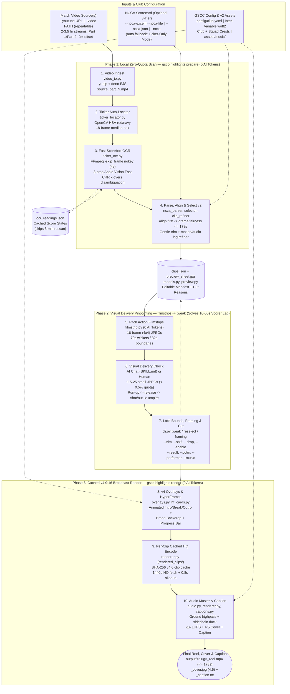

# GSCC Instagram Highlights Reel Generator

Automated local utility for **Golden State Cricket Club (`@goldenstate_cc`)** that turns 2–3.5 hour NCCA YouTube match livestreams and NCCA scorecards into pro-broadcast **under-3-minute (`≤ 178s`, or `≤ 240s` on rare GSCC derbies) `1080×1920` (9:16) Instagram Reels**, ready-to-post **`4:5` Instagram Cover JPEGs**, and **auto-generated Instagram captions**—without burning through AI video-scanning quota.

Supports all four GSCC squads (**GSCC Tigers**, **GSCC Bulls**, **GSCC ThunderCats**, **GSCC Bears**) with bundled high-res squad crests, `Inter Variable` typography, and automatic balanced both-teams mode on intra-club GSCC-vs-GSCC derbies.

> **Companion Google Doc (Optional):** Club members with Drive access can also view the visual multi-tab [GSCC Cricket Highlights Reel Generator — Guide & Architecture](https://docs.google.com/document/d/1qfEopm6rYRhbVKiAc37qBUejRhAjZJDEHgAD2RIL8no/edit?tab=t.0) (includes `v2` rendered Reel previews). Everything required to set up, run, troubleshoot, and contribute is documented directly in this README.

---

## Table of Contents

- [Key Capabilities (`v4` Broadcast Suite)](#key-capabilities-v4-broadcast-suite)
- [System Architecture](#system-architecture)
- [Prerequisites & One-Time Setup (macOS)](#prerequisites--one-time-setup-macos)
- [How to Run: AI Chat vs. Terminal CLI](#how-to-run-ai-chat-vs-terminal-cli)
- [NCCA Scorecard Sources (Browser Automation + Fallback)](#ncca-scorecard-sources-browser-automation--fallback)
- [CLI Reference](#cli-reference)
- [Configuration & Customization (`config/club.yaml`)](#configuration--customization-configclubyaml)
- [Workspace, Caching & Disk Management](#workspace-caching--disk-management)
- [AI Quota Breakdown & Verified Benchmarks](#ai-quota-breakdown--verified-benchmarks)
- [Troubleshooting & FAQ](#troubleshooting--faq)
- [Directory Layout, Module Map & Engineering Invariants](#directory-layout-module-map--engineering-invariants)
- [Running Tests](#running-tests)

---

## Key Capabilities (`v4` Broadcast Suite)

| Feature | How It Works |
|---|---|
| **99% Local (0 Video AI Tokens)** | Downloads streams, auto-locates the CricClubs scorebox, scans 2–3.5 hr footage locally with keyframe-only FFmpeg + native macOS Apple Vision OCR, and renders with VideoToolbox hardware acceleration. |
| **Animated HyperFrames Cards (`v4`)** | `2.9s` live-action intro (sharp cropped backdrop hiding the baked-in scoreboard), `2.8s` Innings Break card (chase maths + GSCC contributors), and `5.5s` outcome-first Full-Time Scorecard rendered via HTML/CSS/GSAP templates (`hyperframes/templates/`) with automatic Pillow fallback (`card_engine: hyperframes \| pillow`) + matching `4:5` Instagram Cover JPEG (`<slug>_cover.jpg`). |
| **Clean Brand Backdrop & Progress (`v4`)** | Static obsidian/maroon brand backdrop behind the match video (replacing muddy blurred footage, with decorative stripes/chevrons removed), per-match smart framing (`framing.py`), a single thin progress bar with an innings-break notch + `N / TOTAL` counter, batter-first wicket hero cards, and `0.8s` delayed slide-in callouts. |
| **Dynamic Broadcast Badges** | Automatically upgrades standard pills for big moments: `BOWLED!`, `CAUGHT & BOWLED`, `STUMPED!`, `RUN OUT!`, `3RD WICKET!`, `4TH WICKET!`, `HAT-TRICK!`, `ALL OUT!`, `BACK-TO-BACK 6!`, and `3 SIXES IN A ROW!`. |
| **Selection v2 (`≤ 178s` / `≤ 240s` Derby)** | Aligns all candidates before budgeting (missing/bulk-jump balls never waste slots); keeps 100% when everything fits; gently trims routine fours (`≥ 4.2s`) and sixes (`≥ 4.8s`) first when slightly over cap (`≤ 18s`); otherwise ranks by cricket drama (`wicket == six` at `80` base + set batters, partnerships broken, multi-wicket overs, hauls, back-to-back boundaries, death overs), protects must-keep anchors, enforces `≥ 30%` innings time & `≥ 25%` wickets floors, never caps bowler wickets, shares batting slots across teammates, and keeps dropped clips as `cut_for_budget` for instant `--enable` or `reselect`. |
| **Broadcast `-14 LUFS` Audio & Sidechain Ducking** | Prompts for music first (built-in 124 BPM beat, custom `.mp3`/`.wav`/`.m4a`, or `none`), high-passes and stem-levels quiet ground audio, automatically ducks music under crowd cheers/appeals, and masters the final mix to Instagram's `-14 LUFS` / `-1.5 dBTP` standard. |
| **Auto Instagram Captions & Single-Folder Guards** | Writes `<slug>_caption.txt` next to every reel (result, scores, standouts, full-match link, hashtags; `gscc-highlights caption <match>` regenerates it) and enforces a single canonical `utils/social/workspace/` + `utils/social/output/` layout (`paths.py` + `consolidate`). |
| **Instant Per-Clip Caching & Two-Tier `1440p` HQ Fetch** | Full-match `prepare` stays fast/compact at `720p`, while `render` automatically streams only the selected clips directly from YouTube at up to **`1440p`/`1080p`** (`7.5 Mbps` VP9/H.264), downscales via `flags=lanczos` + subtle luma micro-sharpening (`CRF 18` / `8M`), and caches every segment in `rendered_clips/` (~2s music swaps, ~3–5s single-clip tweaks). |

---

## System Architecture



### End-to-End Pipeline Stages

| Stage | Module | Execution & Quota | Input → Output |
|---|---|---|---|
| **1. Match Metadata & Events** | `ncca_parser.py` | Local (0 tokens) | NCCA `.xlsx` / `.html` / `.json` / URL → `MatchInfo` + `list[BallEvent]` (50/100 milestones & winning shot tagged) |
| **2. Video Ingest** | `video_io.py` | Local (`yt-dlp` + `deno` + `static-ffmpeg`, 0 tokens) | 1+ YouTube URLs / MP4s → `list[VideoPart]` (`source_part_N.mp4`, resolution, fps, `?t=` offset) |
| **3. Ticker Auto-Detection** | `ticker_locator.py` | Local OpenCV HSV heuristics (0 tokens) | 18 sampled frames → `TickerBoxes(center_box, left_wing, right_wing)` |
| **4. Fast Scorebox OCR** | `ticker_ocr.py` | Local FFmpeg + Apple Vision (0 tokens) | Keyframe-only 4s crop → inner pixel-diff (`2.5`) → 8-crop batched Apple Vision `Fast` → `ocr_readings.json` |
| **5. Align & Selection v2** | `selector.py`, `ticker_ocr.py` | Local deterministic DP/monotonic match (0 tokens) | Strict GSCC filtering + dynamic badges + align-before-select → Selection v2 (`≤ 178s` / `≤ 240s` derby, gentle trim-first, fairness floors) |
| **6. Initial Lag Estimate** | `clip_refiner.py`, `preview.py` | Local 1fps diff + `>300Hz` cheer + 2fps motion burst (0 tokens) | Rough `[start_sec, end_sec]` + `clips.json` (incl. `cut_for_budget` reasons) + `preview_sheet.jpg` |
| **7. Action Filmstrips** | `filmstrip.py` | Local OpenCV + Pillow (0 tokens) | 16-frame pitch-focused JPEGs (`70s` wicket lookback / `32s` boundary lookback) in `filmstrips/` |
| **8. Visual Delivery Pinpointing** | AI Agent (via `SKILL.md`) or Human | ~15–25 small JPEGs (`< 0.5%` video quota; 0 CLI) | Visually verified bowler run-up → ball release → shot/wicket → umpire signal locked via `tweak --trim` |
| **9. Cached `v4` Broadcast Render** | `hf_cards.py`, `overlays.py`, `framing.py`, `captions.py`, `renderer.py` | Local HyperFrames + Pillow + FFmpeg VideoToolbox (0 tokens) | Animated HyperFrames Intro/Break/Outro, brand backdrop, thin progress bar, `-14 LUFS` ducked mix → `utils/social/output/<slug>_reel.mp4`, `_cover.jpg`, `_caption.txt` |

---

## Prerequisites & One-Time Setup (macOS)

> **Platform note:** macOS (Intel or Apple Silicon) is required for native Apple Vision OCR (`pyobjc-framework-Vision`). All dependencies install from prebuilt binary wheels—**no Xcode Command Line Tools or Homebrew builds required**.

```bash
# 1. Install uv (manages Python 3.12 automatically) and deno (YouTube JS runtime for yt-dlp)
curl -LsSf https://astral.sh/uv/install.sh | sh
curl -fsSL https://deno.land/install.sh | sh -s -- -y

# 2. Install Python 3.12 + locked prebuilt dependencies inside this folder
cd utils/social/highlight-reel
~/.local/bin/uv sync --python 3.12 --extra dev

# 3. Verify setup (auto-downloads prebuilt static-ffmpeg once & generates default_hype_beat.wav)
~/.local/bin/uv run gscc-highlights music
```

*(If `uv` is already on your `PATH`, you can run `uv` instead of `~/.local/bin/uv` in all commands below.)*

---

## How to Run: AI Chat vs. Terminal CLI

### Option 1: Via AI Chat (Recommended)

Open this repository in Antigravity or Claude Code (which loads [`.agent/skills/gscc-highlights/SKILL.md`](../../../.agent/skills/gscc-highlights/SKILL.md)) and paste:

```text
Make a GSCC highlights reel for this match:
- YouTube: https://www.youtube.com/watch?v=<VIDEO_ID>&t=<START_SEC>s
- NCCA Scorecard: https://www.nccacricket.org/NCCA/results/<MATCH_TOKEN>
  (or local Export Excel path: ~/Downloads/match_export.xlsx)
- Music: default_hype_beat.wav (or "none" for Instagram native audio, or "/path/to/song.mp3")
```

**Why AI Chat is recommended:**
- 99% of the work (download, OCR scan, alignment, filmstrips, rendering) still runs 100% locally (`0` video tokens).
- Live scorers typically update CricClubs **10–25s late on boundaries** and **30–65s late on wickets**, so the AI inspects only ~15–25 compact JPEG filmstrips (`< 0.5%` of raw video quota) to lock exact bowler run-up → ball release → boundary/wicket → umpire signal timestamps automatically.
- Follow-up edits work in plain English (*"drop clip 3, extend clip 10 by 2s, update POTM to Sharan CK, switch music to none"*), and per-clip caching re-renders only changed clips in seconds.

### Option 2: Direct Terminal CLI (0 AI Tokens)

```bash
cd utils/social/highlight-reel

# 1. List available tracks in assets/music/ (drop any .mp3/.wav/.m4a here)
~/.local/bin/uv run gscc-highlights music

# 2. Scan video & align highlights (repeat --youtube for split Part 1 / Part 2 streams)
~/.local/bin/uv run gscc-highlights prepare \
  --youtube "https://www.youtube.com/watch?v=f6qHjFrW7Iw&t=475s" \
  --ncca-excel ~/Downloads/match_export.xlsx

# 3. Generate 16-frame pitch-focused action filmstrips and visually verify delivery times
~/.local/bin/uv run gscc-highlights filmstrips workspace/<match_slug>
open workspace/<match_slug>/filmstrips/

#    (Optional: 1-second micro-zoom for a tricky wicket)
~/.local/bin/uv run gscc-highlights filmstrips workspace/<match_slug> \
  --clip 14 --window 7870:7884

# 4. Lock exact bowler release -> shot/wicket -> umpire signal timestamps (and optional scorecard metadata)
~/.local/bin/uv run gscc-highlights tweak workspace/<match_slug> \
  --trim 1=622.5:627.3 \
  --trim 2=814.8:819.6 \
  --drop 3

# 5. Render final 1080x1920 Instagram Reel + 4:5 Cover JPEG (add --cleanup to delete raw source MP4s)
~/.local/bin/uv run gscc-highlights render workspace/<match_slug>
```

Outputs are written to `utils/social/output/<match_slug>_reel.mp4`, `utils/social/output/<match_slug>_cover.jpg`, and `utils/social/output/<match_slug>_caption.txt`.

#### One-Command Fast Preview (`run`)

To generate an immediate rough-draft Reel without manual filmstrip review:

```bash
~/.local/bin/uv run gscc-highlights run \
  --youtube "https://youtu.be/eVBiHW4CItg?t=900" \
  --music default_hype_beat.wav
```

*(Note: because live scorers frequently tap wickets 30–65 seconds late, running `filmstrips` + `tweak` before posting to `@goldenstate_cc` is strongly recommended.)*

---

## NCCA Scorecard Sources (Browser Automation + Fallback)

`nccacricket.org` is a client-rendered Next.js app (and occasionally serves a Cloudflare verification gate to automated HTTP/headless clients). The pipeline handles this across 5 tiers:

| Flag | Source | Notes |
|---|---|---|
| `--ncca-json <file.json>` | **Automatic in AI Chat.** The `/gscc-highlights` skill opens the NCCA URL with the built-in browser agent, reads the rendered Scorecard & Ball-by-Ball tabs, and writes `workspace/<slug>/ncca_match.json`. | Zero manual downloads; preserves pre-computed `score_runs_after` on highlight-only JSONs. |
| `--ncca <url>` | Live NCCA results URL (CLI). | Tries direct HTTP, then automatically launches local Chrome via `puppeteer-core` (`--browser-ncca`) to capture the rendered scorecard/commentary. If blocked by Cloudflare or empty, **prompts interactively** for Excel/HTML (with how-to steps) or Ticker-Only mode (or falls back in `--non-interactive` mode). |
| `--ncca-excel <file.xlsx>` | **Recommended offline input.** Open the NCCA match page → **Info** tab → click **Export Excel**. | Zero Cloudflare friction; gives official match metadata, player names, milestones, and ball-by-ball events. |
| `--ncca-file <file.html>` | Browser-saved (`Cmd+S`) NCCA **Ball by Ball** tab HTML (wait for deliveries to load first). | Full offline parsing via BeautifulSoup (handles inline formatting spans from Next.js DOM). |
| *(omitted)* | **Ticker-Only Mode** | Infers boundaries (`+4`/`+6`), wickets, and batters/bowlers directly from the video's CricClubs ticker wings, and auto-derives Outro `GSCC STANDOUTS` directly from selected clips. |

*(NCCA wall-clock timestamps are intentionally ignored because post-match scorer edits overwrite wall-clock times in batches; video synchronization always anchors to score/over transitions on the stream ticker.)*

---

## CLI Reference

Run commands from `utils/social/highlight-reel/` with `uv run gscc-highlights <subcommand> [options]` (or from repo root via `uv --directory utils/social/highlight-reel run gscc-highlights ...`). Global flag: `--config <path>` (before subcommand) loads an alternate YAML config.

### Subcommand Overview

| Subcommand | Purpose |
|---|---|
| `prepare` | Downloads/probes video(s), locates score ticker, runs Apple Vision OCR, aligns all NCCA/Ticker-Only events first, runs Selection v2 (`≤ 178s` / `≤ 240s` derby), refines kept clips, and creates `clips.json` & `preview_sheet.jpg`. |
| `filmstrips` | Generates 16-frame pitch-focused timestamped action strips in `utils/social/workspace/<slug>/filmstrips/` for delivery-to-shot/wicket verification. |
| `tweak` | Applies shifts, exact trims, drops/enables (auto-refines restored `cut_for_budget` clips), headline/subtext/badge overrides, match scorecard metadata updates, or music changes to `clips.json` and refreshes `preview_sheet.jpg`. |
| `reselect` | Re-runs Selection v2 on an existing workspace's `clips.json` (e.g. `--max-duration 90` or `178`) without re-running OCR, toggling `cut_for_budget` clips and refreshing `preview_sheet.jpg`. |
| `framing` | Shows, re-detects (`--reanalyze`), or manually overrides (`--height`/`--center`) the per-match video crop window (`framing.json` + `framing_preview.jpg`). |
| `render` | Composites and encodes `utils/social/output/<slug>_reel.mp4` (`1080×1920`, `30fps`, `≤ 178s` / `≤ 240s` derby, `-14 LUFS`), `<slug>_cover.jpg`, and `<slug>_caption.txt` using HyperFrames cards, per-clip caching, HQ clip fetch, and VideoToolbox hardware acceleration. |
| `caption` | (Re)writes `utils/social/output/<slug>_caption.txt` (result, scores, standouts, full-match link, hashtags) without re-rendering video. |
| `consolidate` | Merges any stray `workspace/` or `output/` folders into the single canonical `utils/social/workspace/` and `utils/social/output/` (dry-run by default; pass `--apply` to move). |
| `run` | Convenience command combining `prepare` and `render` back-to-back. |
| `music` | Synthesizes `default_hype_beat.wav` if missing and lists all available tracks in `assets/music/`. |

### `prepare` (and `run`) Flags

| Flag | Default / Type | Description |
|---|---|---|
| `--youtube URL` | Repeatable | YouTube match URL (`?t=900` sets initial scan offset). Pass multiple times for split Part 1 / Part 2 streams. |
| `--video PATH` | Repeatable | Local `.mp4`/`.mov` path (referenced directly without copying). Combinable with `--youtube`. |
| `--ncca URL` | Optional | Live NCCA results URL (auto falls back to Ticker-Only Mode if Cloudflare blocks CLI). |
| `--ncca-excel PATH` | Optional | NCCA **Export Excel (`.xlsx`)** scorecard file (recommended offline NCCA input). |
| `--ncca-file PATH` | Optional | Browser-saved (`Cmd+S`) NCCA Ball-by-Ball HTML file. |
| `--ncca-json PATH` | Optional | Structured NCCA match JSON file. |
| `--mode` | `gscc-only` | `gscc-only` or `both`. Auto-switches to `both` on intra-club GSCC-vs-GSCC derbies. |
| `--music CHOICE` | Interactive | Filename in `assets/music/`, full path to custom `.mp3`/`.wav`/`.m4a`, or `none` (ground audio only). |
| `--start-time SEC` | From `?t=` / `0` | Seconds to skip pre-match warmup before OCR scanning. |
| `--ticker-box X,Y,W,H` | Auto-detected | Manual center scorebox pixel bounds for non-standard stream graphics. |
| `--max-duration SEC` | `178.0` (`240.0` derby) | Hard maximum reel duration in seconds (under Instagram's 3:00 limit; includes intro, innings break, and outro). |
| `--title TEXT` | Auto | Override match title displayed on Intro Card and Top Broadcast Bar. |
| `--cookies-from-browser` | Optional | Pass browser cookies (`chrome`, `safari`) to `yt-dlp` for unlisted/throttled streams. |
| `--non-interactive` | `false` | Skip interactive music prompt (uses `--music` or default beat). |
| `--rescan-ocr` | `false` | Ignore `ocr_readings.json` cache and re-run Apple Vision OCR scan. |
| `--browser-ncca` / `--no-browser-ncca` | `true` | Automatically launch local Chrome via `puppeteer-core` when `--ncca` returns a client-rendered shell. |
| `--allow-ticker-fallback` / `--no-allow-ticker-fallback` | `true` | Automatically fall back to Ticker-Only OCR mode if NCCA fetch fails in `--non-interactive` mode (interactive runs prompt for Excel/HTML or Ticker-Only). |

*(Additional `run`-only flags: `--output PATH`, `--cleanup`.)*

### `filmstrips` Flags

| Flag | Default / Type | Description |
|---|---|---|
| `match_dir` | Positional | Path to `workspace/<match_slug>`. |
| `--clip ID` | Repeatable (all) | Limit generation to specific clip ID(s). |
| `--window START:END` | Optional | Tight micro-zoom window in seconds (e.g., `--window 10929:10944` gives ~1s frame spacing across 16 frames). |
| `--frames N` | `16` | Number of frames rendered on the 4-column grid. |
| `--full-frame` | `false` | Disable gentle pitch-band crop (`y=12%..76%, x=5%..95%`). |

### `tweak` Flags

| Flag | Example | Description |
|---|---|---|
| `match_dir` | `workspace/<slug>` | Path to match workspace directory. |
| `--shift ID=DELTA` | `--shift 4=-8` | Shift `start_sec` and `end_sec` of clip `ID` by `DELTA` seconds. Repeatable. |
| `--trim ID=START:END` | `--trim 10=7692.5:7700.0` | Set exact bounds, enable clip, and mark status `ok (high)`. Repeatable. |
| `--drop ID` | `--drop 13` | Disable clip `ID` without deleting it from `clips.json`. Repeatable. |
| `--enable ID` | `--enable 5` | Re-enable a disabled, `bulk_jump`, or `cut_for_budget` clip (automatically refines restored budget-cut clips). Repeatable. |
| `--headline ID=TEXT` | `--headline "21=Clutch Run Out!"` | Override bold hero headline on the lower callout card. Repeatable. |
| `--subtext ID=TEXT` | `--subtext "21=Direct hit from cover"` | Override detail text line on the lower callout card. Repeatable. |
| `--badge ID=TEXT` | `--badge "10=MASSIVE SIX"` | Override colored event pill (`MAXIMUM 6`, `WICKET!`, `RUN OUT!`, `FOUR!`, `HALF CENTURY 50*`, etc.). Repeatable. |
| `--title TEXT` | `--title "GSCC Bulls vs Monks"` | Override match title on Intro and Top Broadcast Bar. |
| `--result TEXT` | `--result "GSCC Bulls won by 6 Wickets"` | Override final match result on the Full-Time Scorecard (automatically switches status pill to `FULL TIME`). |
| `--potm NAME` | `--potm "Sharan CK"` | Override Player of the Match badge on the Full-Time Scorecard. |
| `--performer TEXT` | `--performer "Sharan CK 77* (47)"` | Set `GSCC STANDOUTS` rows on the Outro (`BAT`/`BOWL` tags auto-detected). Repeatable. |
| `--series TEXT` | `--series "2026 Winter T20 WB-D3"` | Override tournament/series label on Intro, Top Bar, and Outro. |
| `--date TEXT` | `--date "Nov 14, 2026"` | Override match date label. |
| `--venue TEXT` | `--venue "East Avenue Middle School"` | Override venue label on Intro. |
| `--youtube-url URL` | `--youtube-url "https://youtu.be/..."` | Attach/override Part 1 source YouTube URL for two-tier `1440p`/`1080p` HQ clip fetch. |
| `--music CHOICE` | `--music none` | Update saved music choice in `clips.json`. |

### `render` Flags

| Flag | Default | Description |
|---|---|---|
| `match_dir` | Positional | Path to `workspace/<match_slug>`. |
| `--music CHOICE` | From `clips.json` | Override music for this render without re-encoding cached video clips (~2s audio remux!). |
| `--output PATH` | `output/<slug>_reel.mp4` | Custom output MP4 path (`*_cover.jpg` is saved right beside it). |
| `--framing MODE` | From `club.yaml` (`auto`) | `auto` detects action position once per match (`framing.json`) and crops up to `800px` tall; `full` keeps the whole `16:9` frame. |
| `--hq` / `--no-hq` | `true` | Automatically fetch selected highlight clips directly at `1080p`/`1440p` from YouTube when local proxy is `720p`. |
| `--hq-url URL` | From `clips.json` | Optional one-off YouTube URL override for `1440p`/`1080p` HQ clip fetching. |
| `--cookies-from-browser` | Optional | Browser cookies (`chrome`, `safari`) for HQ YouTube clip fetch on restricted streams. |
| `--no-cache` | `false` | Ignore `rendered_clips/` cache and re-encode every clip fresh. |
| `--cleanup` | `false` | Delete downloaded `source_part_*.mp4` files after verifying the output MP4. |

---

## Configuration & Customization (`config/club.yaml`)

All branding, squad crests, typography, pacing, motion timings, broadcast loudness targets, and Instagram Safe Zones live in [`config/club.yaml`](config/club.yaml)—no code changes required:

```yaml
club:
  name: "Golden State Cricket Club"
  instagram_handle: "@goldenstate_cc"
  logo_path: "assets/logos/gscc_logo.png"
  squad_logos:
    tigers: "assets/logos/gscc_tigers.png"
    bulls: "assets/logos/gscc_bulls.png"
    thundercats: "assets/logos/gscc_thundercats.png"
    bears: "assets/logos/gscc_bears.png"
  font_variable_path: "assets/fonts/Inter-Variable.woff2"
  colors:
    maroon_primary: "#8C1D18"
    crimson_signal: "#D92B2B"
    crimson_glow: "#9E1B1B"
    gold_accent: "#C9A227"
    gold_soft: "#E9C86B"
    obsidian_deep: "#0E0C0B"

paths:
  workspace_dir: "../workspace"    # Shared GSCC/utils/social/workspace/ (gitignored)
  output_dir: "../output"          # Shared GSCC/utils/social/output/ (gitignored)

selection:
  default_mode: "gscc-only"
  max_duration_sec: 178.0          # Under Instagram 3:00 Reels limit
  derby_max_duration_sec: 240.0    # Extended cap for rare intra-club GSCC derbies
  target_duration_sec: 170.0
  intro_sec: 2.9
  innings_break_sec: 2.8
  outro_sec: 5.5
  transition_sec: 0.0
  priority_weights: { hundred: 100, winning_shot: 96, fifty: 92, six: 80, wicket: 80, four: 55 }
  min_innings_share: 0.30
  min_wicket_share: 0.25
  min_wickets_for_floor: 4
  first_player_bonus: 6
  multi_shot_batter_first_bonus: 10
  batter_diminishing_penalties: [0, 0, 0, -12, -22, -32]  # batting boundaries only; bowlers never capped
  squeeze_before_drop: true        # gently trim routine 4s (>=4.2s) & 6s (>=4.8s) if <=18s over cap
  squeeze_max_overage_sec: 18.0
  min_four_sec: 4.2
  min_six_sec: 4.8

audio:
  music_db: -11.0
  target_lufs: -14.0
  true_peak_db: -1.5
  ground_target_lufs: -19.0
  enable_ducking: true

render:
  framing_mode: auto
  intro_backdrop: sharp
  intro_crop_top: 0.76             # crops out baked-in bottom scoreboard on intro
  card_engine: hyperframes         # animated intro/break/outro (auto-falls back to pillow)
  card_reveal_delay_sec: 0.8
  card_slide_sec: 0.32
  export_cover_jpg: true
  hq_clip_fetch: true
  hq_max_height: 1440
  sharpen_amount: 0.42
  video_bitrate: "8M"
  crf: 18
```

- **Custom Music:** Drop any `.mp3`, `.wav`, or `.m4a` file into `assets/music/`. It automatically appears in `gscc-highlights music` and interactive prompts.
- **Custom Logos & Fonts:** Bundled `assets/fonts/Inter-Variable.woff2` and `assets/logos/*.png` work out of the box and can be swapped anytime via `club.yaml`.
- **Instagram Safe Zones:** Configured under `render:` (`safe_top_y: 220`, `video_y: 520`, `video_height: 608`, `safe_bottom_y: 1480`, `safe_right_x: 910`). Verified automatically by unit tests.

---

## Workspace, Caching & Disk Management

Each match creates a gitignored workspace folder alongside the final rendered Reel and Instagram Cover inside the shared **`utils/social/`** directories:

```text
utils/social/workspace/<match_slug>/
├── source_part_1.mp4          # Downloaded YouTube stream (~1.2–2.3 GB for 2–3.5 hr 720p)
├── ocr_readings.json          # Cached Apple Vision score transitions (skips 3-min rescan)
├── clips.json                 # Editable ProjectManifest (timestamps, scores/reasons, metadata, music)
├── framing.json               # Cached per-match action crop window (+ framing_preview.jpg)
├── preview_sheet.jpg          # Contact sheet of selected clips + cut_for_budget summary
├── filmstrips/                # 16-frame full-frame action JPEGs (clip_XX.jpg, zoom strips)
├── hyperframes/               # Cached rendered HyperFrames intro / innings break / outro cards
├── overlays/                  # Cached v4 Pillow RGBA PNG layers & static brand backdrop
└── rendered_clips/            # SHA-256 cached 9:16 segment MP4s (instant tweaks & ~2s music swaps)

utils/social/output/
├── <match_slug>_reel.mp4      # Final 1080x1920 @ 30fps Instagram Reel (<= 178s, ~-14 LUFS)
├── <match_slug>_cover.jpg     # Clean 1080x1920 cover centered for Instagram's 4:5 profile grid
└── <match_slug>_caption.txt   # Ready-to-paste Instagram caption, standouts, full-match link & hashtags
```

- **While tweaking clips:** Keep `utils/social/workspace/<match_slug>/` intact so `ocr_readings.json` and `rendered_clips/` keep iterations near-instant. All CLI subcommands (`filmstrips`, `tweak`, `framing`, `render`) accept either a bare `<match_slug>` or full path.
- **After posting:** Reclaim gigabytes while keeping `utils/social/output/<match_slug>_reel.mp4` by passing `--cleanup` to `render` (deletes `source_part_*.mp4`) or deleting `utils/social/workspace/<match_slug>/`.
- Both `utils/social/workspace/` and `utils/social/output/` are gitignored at repo root so large media binaries never enter git history.

---

## AI Quota Breakdown & Verified Benchmarks

### Token Cost Breakdown

| Task | AI Tokens Used | Engine |
|---|---|---|
| Downloading 2–3.5 hr YouTube livestream | **0** | Local `yt-dlp` + `deno` |
| Auto-locating score ticker & scanning 3.5 hrs of video | **0** | Local FFmpeg (`-skip_frame nokey`) + Apple Vision OCR |
| Aligning NCCA events & building 16-frame action filmstrips | **0** | Local Python + OpenCV + Pillow |
| Visual delivery pinpointing (AI Chat mode) | **Very Low (~15–25 small JPEGs)** | `< 0.5%` of raw video cost; safe across an entire season |
| Rendering `v2` Broadcast Reel, `-14 LUFS` mix & `4:5` cover | **0** | Local Pillow + FFmpeg VideoToolbox |
| Pure Terminal CLI mode (manual filmstrip review) | **0 total** | 100% local/offline execution |

### Verified Real-Match Benchmarks (`v2`–`v4`)

Tested end-to-end on an Intel MacBook Pro (Core i5-8259U, macOS 15, ~2.5–3.5 min local OCR scan):

| Match | Stream Length & Camera | Highlights Found & Pinpointed | Final Reel Output |
|---|---|---|---|
| **All Stars Lions & Cubs vs GSCC Tigers** (2026 Winter T20 WB-D2, `v4`) | 3h 12m stream (`720p` scan proxy + **`1440p` HQ per-clip fetch**), full NCCA JSON + Selection v2 + HyperFrames | 23 in-video GSCC events (10 wickets incl. Shraddhan `4/13`, Vinay `4/37`, all-out + Ritesh `50 (31)`, back-to-back 6s) | `170.4s` (`2m 50.4s`, `≤ 178s`), `1080×1920 @ 30fps`, `166.6 MB` + `4:5` Cover JPG + Caption TXT |
| **GSCC Bulls vs Livermore Monks** (2026 Winter T20 WB-D3) | 2h 12m 720p wide tripod (`534, 559, 212, 76` scorebox), Ticker-Only Part 1 | 12/12 GSCC events on tape (all 7 wickets incl. diving run-out + all 5 Sharan C boundaries/sixes) | `103.7s` (`1m 43.7s`), `1080×1920 @ 30fps`, `27.9 MB`, **`-15.6 LUFS`** + `4:5` Cover JPG |
| **GSCC Tigers vs Afghan Atalan** (2026 Summer T20 D1 Final) | 3h 39m stream (`720p` scan proxy + **`1440p` HQ per-clip fetch**, `7.5 Mbps` VP9), full NCCA metadata | 21/21 official NCCA highlights matched (~94% OCR parse rate); 17 clips + `2.8s` Innings Break + `5.5s` Outcome Scorecard | `116.1s` (`1m 56.1s`), `1080×1920 @ 30fps`, `7.6 Mbps` (`108.5 MB`), **`-14.4 LUFS`** + `4:5` Cover JPG |

---

## Troubleshooting & FAQ

| Symptom / Scenario | Cause | Fix |
|---|---|---|
| **NCCA URL prints "Cloudflare challenge"** | `nccacricket.org` challenges direct Python HTTP clients. | Click **Export Excel** on the NCCA match page and pass `--ncca-excel <file.xlsx>`, pass a browser-saved `--ncca-file <file.html>`, or omit `--ncca` for automatic **Ticker-Only Mode**. |
| **Match split across 2+ YouTube streams** | Livestream restarted mid-match. | Pass `--youtube` multiple times in chronological order (`--youtube URL1 --youtube URL2`). Unrecorded balls are safely marked `missing_in_video`. |
| **YouTube download returns HTTP 403 or bot check** | Missing JS runtime or unlisted/rate-limited stream. | Verify `~/.deno/bin/deno` is installed (the CLI passes `--js-runtimes deno:... --remote-components ejs:github` automatically). For unlisted/throttled videos, add `--cookies-from-browser chrome` (or `safari`). |
| **Clip flagged `bulk_jump` and disabled** | Scorer fell behind and bulk-entered multiple overs at once. | Keep disabled, or inspect the approximate minute via `gscc-highlights filmstrips <dir> --clip ID --window START:END` and lock it with `tweak --trim`. |
| **Wicket clip shows celebration instead of the delivery** | CricClubs scorers often take 30–65s to tap Out → Type → Fielder → New Batter. | Run `gscc-highlights filmstrips <dir> --clip ID` (70s lookback default), spot the bowler run-up second, and apply `tweak --trim ID=START:END`. |
| **Want to update Outro result / POTM / Standouts on a Ticker-Only match** | Ticker-Only mode doesn't have NCCA's post-match award metadata. | Run `gscc-highlights tweak workspace/<slug> --result "GSCC Bulls won by 6 Wickets" --potm "Sharan CK" --performer "Sharan CK 77* (47)"` and re-run `render` (reuses all cached video clips!). |
| **Non-standard or moved score ticker** | Custom PRISM Live overlay geometry or colors. | Pass `--ticker-box X,Y,W,H` (pixel bounds of center scorebox) to `prepare`. |
| **Apple Vision throws `Code=-6662` inside an AI sandbox** | macOS Seatbelt sandbox blocks CoreVideo `IOSurface` IPC. | Run `prepare` in a normal Terminal or unsandboxed shell (`filmstrips`, `tweak`, `render`, and `pytest` run cleanly sandboxed). |
| **Want to swap background song after rendering** | Audio is mixed in a final fast mastering pass. | Run `gscc-highlights render workspace/<slug> --music /path/to/song.mp3` (or `--music none`). Reuses 100% of cached video clips (~2–3s!). |

---

## Directory Layout, Module Map & Engineering Invariants

```text
utils/social/highlight-reel/
├── README.md                  # This complete guide
├── pyproject.toml             # uv / Python 3.12 project & CLI entry point
├── uv.lock                    # Locked prebuilt wheel dependencies
├── config/club.yaml           # GSCC colors, squads, typography, loudness, motion & safe zones
├── assets/
│   ├── fonts/
│   │   └── Inter-Variable.woff2    # Bundled Inter Variable font (weights 400–900)
│   ├── logos/
│   │   ├── gscc_logo.png           # Official GSCC Club crest (512px)
│   │   ├── gscc_tigers.png         # GSCC Tigers crest (512px)
│   │   ├── gscc_bulls.png          # GSCC Bulls crest (512px)
│   │   ├── gscc_thundercats.png    # GSCC ThunderCats crest (512px)
│   │   └── gscc_bears.png          # GSCC Bears crest (512px)
│   └── music/README.txt            # Drop-in folder for custom tracks (default beat auto-generated)
├── hyperframes/
│   ├── templates/                  # Animated HTML/CSS/GSAP intro, innings break & full-time cards
│   └── assets/                     # Bundled GSAP + Inter-Variable.woff2 for offline HyperFrames renders
├── src/gscc_highlights/       # Core pipeline modules
└── tests/                     # Automated pytest suite (40 tests)
```

### Module Map (`src/gscc_highlights/`)

- **`cli.py`**: Argument parser and subcommand orchestration (`prepare`, `filmstrips`, `tweak`, `reselect`, `framing`, `render`, `caption`, `consolidate`, `run`, `music`).
- **`config.py`**: Root discovery, typed `ClubConfig` loader for `config/club.yaml`, safe `is_gscc_team()` matching (`GSB`/`GST`/`GSTC`/`GSBR`), and `squad_logo_path()` crest resolution.
- **`paths.py`**: Single-workspace / single-output path guards (`utils/social/workspace/` & `utils/social/output/`), stray-folder warnings, and `consolidate` migration helper.
- **`models.py`**: Dataclasses (`VideoPart`, `InningsSummary`, `BallEvent`, `HighlightCandidate`, `TickerReading`, `ClipSpec`, `MatchInfo`, `ProjectManifest`) and backward-compatible JSON serialization for `clips.json`.
- **`video_io.py`**: Prebuilt `static-ffmpeg` & `~/.deno/bin/deno` resolution, `yt-dlp` EJS flags, `?t=` offset parsing, and multi-part probing.
- **`ncca_parser.py`**: 5-tier NCCA parser (live URL + local Chrome `puppeteer-core`, saved HTML, Export Excel via `openpyxl`, structured JSON, graceful fallback).
- **`ticker_locator.py`**: OpenCV HSV red `OVERS` + dark-navy scorebox detection across 18 sampled frames (bottom 32% band), taking the median box with expanded wing regions.
- **`ticker_ocr.py`**: Keyframe-only 4s coarse scanner, single-threaded 8-crop Apple Vision `Fast` batching, `CRR × overs` slash-as-`1` disambiguation, temporal denoising, score-reset innings segmentation, gap-tolerant DP alignment (propagating Selection v2 metadata), and Ticker-Only Mode.
- **`selector.py`**: Selection v2 drama/fairness engine (`≤ 178s` normal / `≤ 240s` derby), dynamic broadcast badges (`BOWLED!`, `CAUGHT & BOWLED`, `STUMPED!`, `3RD/4TH WICKET!`, `HAT-TRICK!`, `ALL OUT!`, `BACK-TO-BACK 6!`), gentle trim-first when slightly over cap, uncapped bowler wickets, batting diminishing returns + teammate first-shot boost, `≥ 30%` innings / `≥ 25%` wicket floors, and shared `enforce_budget_on_clips()` used by `prepare`, `reselect`, and `renderer.py`.
- **`clip_refiner.py`**: 1fps ticker-flip refinement, `prev_ball_flip_sec`-bounded wicket lookbacks, and fused high-pass (`300–4500 Hz`) audio cheer + 2fps visual motion-burst delivery detection.
- **`filmstrip.py`**: `4×4` (16-frame) pitch-focused timestamped JPEG grids with `--window` micro-zoom support.
- **`preview.py`**: `preview_sheet.jpg` contact sheet generator (3-frame boundary / 5-frame wicket lookback, Selection v2 score/reason lines, and `cut_for_budget` footer).
- **`framing.py`**: Per-match motion-profile framing detector (`framing.json` + `framing_preview.jpg`) selecting the tallest safe video band (`608`–`800px`) and horizontal crop centre, plus shared `Layout` geometry.
- **`hf_cards.py`**: Zero-setup HyperFrames runtime manager (`/var/tmp/gscc-hyperframes-<uid>` with portable Node 22 + headless Chrome, telemetry disabled) rendering animated intro, innings break, and full-time cards with automatic Pillow fallback.
- **`captions.py`**: Auto-generates Instagram `<slug>_caption.txt` (result, scores, standouts, clean YouTube full-match link, hashtags) after every render or via `gscc-highlights caption`.
- **`overlays.py`**: `v4` `1080×1920` Pillow renderer using bundled `Inter Variable` + club/squad crests, clean brand clip backdrop (`decor=False`), thin continuous progress bar + innings-break notch + `N / TOTAL` counter, batter-first wicket lower cards, `4:5` cover exporter, and static fallback Intro / Innings Break / Full-Time cards.
- **`audio.py`**: NumPy + `wave` 124 BPM royalty-free hype beat synthesizer, `assets/music/` scanner, and music-first prompt.
- **`renderer.py`**: Per-clip SHA-256 cache (`OVERLAY_SCHEMA_VERSION = "v4.0"`), HyperFrames animated cards with Pillow fallback, smart framing (`framing.py`), static brand backdrop, two-tier `1440p`/`1080p` direct HQ clip fetch + `flags=lanczos` + luma micro-sharpening (`CRF 18` / `8M`), `0.8s` delayed cubic ease-out lower-card slide-in, `h264_videotoolbox` with `libx264` fallback, unified Selection v2 budget enforcement (`≤ 178s` / `≤ 240s` derby), and two-stage `-14 LUFS` / `-1.5 dBTP` broadcast audio mastering with sidechain ducking.

### Critical Engineering Invariants (For Contributors & AI Agents)

1. **Scorecard Updates Lag 10–65s:** Always treat scorecard/ticker flips as rough timeframe markers and verify delivery timing via `filmstrips` + `tweak --trim` before final render.
2. **Keyframe-Only Decode & No `stderr` Pipe Deadlock:** Keep `-skip_frame nokey` (cuts 3.5 hr decode from ~10 min to ~45s on Intel i5) and `stderr=subprocess.DEVNULL` (prevents 64KB pipe buffer deadlocks).
3. **Single-Threaded Batched Apple Vision + Autorelease Pool:** Keep single-threaded 8-crop `Fast` batches (2× upscaled) inside `with objc.autorelease_pool():` (~280ms/crop, 91–94% accuracy). Concurrent threads deadlock CoreVideo/Metal on Intel macOS 15, and `Accurate` mode is ~15× slower without ANE.
4. **macOS Seatbelt Sandbox vs. Apple Vision IOSurface:** CoreVideo `CVPixelBufferCreate` returns `Code=-6662` inside sandboxed shells; `prepare` requires host IOSurface access while all downstream commands run cleanly sandboxed.
5. **CricClubs `/` Read as `1` & Dimmed Team Codes:** Preserve `CRR × overs` no-slash disambiguation (fixes `103/4` read as `10314`) and genuine score-reset innings detection (`runs ≤ 15, wickets ≤ 2` after substantial Innings 1) since CricClubs keeps both team codes visible across innings.
6. **Cache-Safe Top Bar & Complete SHA-256 Cache Keys:** Keep per-clip top bars free of clip-index counters (`CLIP N/M`) so dropping/reordering one clip never invalidates unchanged cached MP4 segments.
7. **Zero Xcode CLT / Intel `x86_64` Wheel Safety:** Do not add `onnxruntime` or source-compiled packages to `pyproject.toml`; keep prebuilt `pyobjc-framework-Vision` (`universal2`), `static-ffmpeg`, and `opencv-python-headless`.
8. **Agent Skill Protocol:** Keep [`.agent/skills/gscc-highlights/SKILL.md`](../../../.agent/skills/gscc-highlights/SKILL.md) aligned with CLI behavior so AI-assisted runs always ask music first, scan locally, pinpoint via filmstrips, and render cached.

---

## Running Tests

```bash
cd utils/social/highlight-reel
~/.local/bin/uv run pytest -v
```


---

## v3 Framing, Intro & Card Options

| Option | Where | What it does |
|---|---|---|
| `render.framing_mode` | `config/club.yaml` / `render --framing auto\|full` | `auto` measures (locally, zero quota) where motion happens across the highlight clips **once per match**, picks the biggest video band (up to 800px) that still contains the action, and uses the **same crop window for every clip**. Cached in `workspace/<slug>/framing.json` with a `framing_preview.jpg` (gold box = visible area). Wide-action matches automatically stay on the full 16:9 frame. `full` always shows the whole frame. |
| `gscc-highlights framing <workspace/slug>` | CLI | Show the detected framing. `--reanalyze` re-detects; `--height 608\|680\|740\|800 --center 0..1` sets a manual override that auto-detection never overwrites. |
| `render.intro_backdrop` | `config/club.yaml` | `sharp` (default: crisp action frame behind the intro text) or `blurred` (moody legacy look). |

Other v3 behaviours: generic series labels such as bare `NCCA` are hidden; the intro shows a stakes chip (`WON BY…` on a GSCC win, a score line on other results, `CHASING N` on a partial stream); highlight cards show a big live score, the dismissed batter as the hero line on wickets, and a reel progress bar; the innings-break card shows chase maths (`N OFF 120 BALLS • RRR`) and GSCC's own bowlers/batters.


---

## v4: HyperFrames Cards, Brand Backdrop, Captions

| Feature | Details |
|---|---|
| **Animated cards via [HyperFrames](https://github.com/heygen-com/hyperframes)** | The intro (`2.9s`), innings break and full-time card are HTML/CSS/GSAP templates in `hyperframes/templates/` rendered in headless Chrome and re-encoded to match every other segment. Content comes from the same helpers as the static cards (`hf_cards.py`), so result / chase maths / standouts logic lives in one place. `render.card_engine: hyperframes` (default) auto-falls back to the static Pillow cards if Node/Chrome can't be set up; set `pillow` to force the static cards. |
| **Zero-setup runtime** | First run downloads a portable Node 22 (only if your Node is older) and headless Chrome into `/var/tmp/gscc-hyperframes-<uid>` (mode 700; HyperFrames refuses to run Chrome/FFmpeg from folders other users could write, e.g. a world-writable home dir). Telemetry is disabled. |
| **Intro backdrop** | Sharp action frame with the top `render.intro_crop_top` (default `0.76`) of the frame kept, so the baked-in CricClubs scoreboard is cropped out, centred on the per-match action position from `framing.json`. `render.intro_backdrop: blurred` restores the moody blurred look. |
| **Brand backdrop on clips** | The muddy blurred copy of the footage behind the video band is replaced by a static brand backdrop (no decorative lines). Decorative stripes/chevrons are removed from all cards. |
| **Reel progress** | One thin bar with an innings-break notch and an `N / TOTAL` counter instead of one dash per clip. |
| **Instagram caption** | `<slug>_caption.txt` is written next to every reel (result line, scores, standouts, full-match YouTube link, hashtags). `gscc-highlights caption <match>` regenerates it without re-rendering. When the stream stops midway, supply the NCCA scorecard (`--ncca-excel`, `--ncca-file`, `--ncca-json` or `--ncca`) so the result, final scores, Player of the Match and standouts come from NCCA. |
| **Selection v2 (`≤ 178s` / `≤ 240s` derby)** | Aligns all candidates before budgeting so missing/bulk-jump balls never waste slots; keeps 100% when everything fits; gently trims routine fours (`≥ 4.2s`) and sixes (`≥ 4.8s`) first when slightly over cap (`≤ 18s`); otherwise ranks by cricket drama (`wicket == six` at `80` base + set batters, broken partnerships, multi-wicket overs, hauls, back-to-back boundaries, death overs), protects must-keep anchors (centuries, boundary fifties, close-game/six winning shots, hat-tricks, all-out 10th wickets), enforces `≥ 30%` innings time and `≥ 25%` wickets floors, never caps bowler wickets, shares batting slots across teammates (`+10` first-clip boost for 2+ boundary batters; diminishing returns on batting boundaries only), and keeps cut clips in `clips.json` as `cut_for_budget` for instant `tweak --enable <id>` or `gscc-highlights reselect <match> --max-duration <sec>`. |


---

## One Workspace, One Output

All match data lives in **`utils/social/workspace/<match_slug>/`** and all reels/covers/captions in **`utils/social/output/`**; never anywhere else. Guards (`paths.py`):

- New match folders always resolve to the canonical workspace (bare slugs and paths that don't exist yet never create anything relative to the current directory).
- An explicit `--output` inside the repo but outside `utils/social/output/` is redirected there (paths outside the repo, e.g. temp dirs, are respected).
- Every CLI run warns if a stray `workspace/` or `output/` folder exists (repo root, `utils/`, `highlight-reel/`, current directory).
- `gscc-highlights consolidate` merges strays into the canonical folders: dry-run by default, `--apply` to move, never overwrites existing files. Existing stray folders keep working when addressed by explicit path, so in-flight sessions are not broken.
