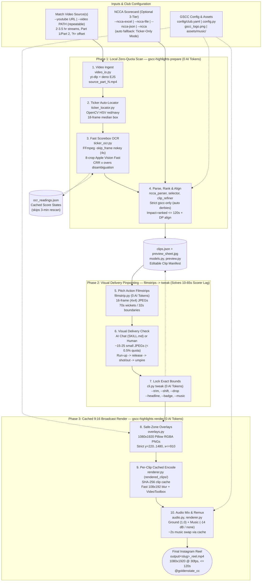

# GSCC Instagram Highlights Reel Generator

Automated local utility for **Golden State Cricket Club (`@goldenstate_cc`)** that turns 2–3.5 hour NCCA YouTube match livestreams and NCCA scorecards into polished **1–2 minute `1080×1920` (9:16) Instagram Reels**—without burning through AI video-scanning quota.

Supports all four GSCC squads (**GSCC Tigers**, **GSCC Bulls**, **GSCC ThunderCats**, **GSCC Bears**) and automatically switches to balanced both-teams mode on intra-club GSCC-vs-GSCC derbies.

> **Companion Google Doc (Optional):** Club members with Drive access can also view the visual multi-tab [GSCC Cricket Highlights Reel Generator — Guide & Architecture](https://docs.google.com/document/d/1qfEopm6rYRhbVKiAc37qBUejRhAjZJDEHgAD2RIL8no/edit?tab=t.0) (includes rendered Reel previews). Everything required to set up, run, troubleshoot, and contribute is documented directly in this README.

---

## Table of Contents

- [Key Capabilities](#key-capabilities)
- [System Architecture](#system-architecture)
- [Prerequisites & One-Time Setup (macOS)](#prerequisites--one-time-setup-macos)
- [How to Run: AI Chat vs. Terminal CLI](#how-to-run-ai-chat-vs-terminal-cli)
- [NCCA Scorecard Sources (3-Tier Fallback)](#ncca-scorecard-sources-3-tier-fallback)
- [CLI Reference](#cli-reference)
- [Configuration & Customization (`config/club.yaml`)](#configuration--customization-configclubyaml)
- [Workspace, Caching & Disk Management](#workspace-caching--disk-management)
- [AI Quota Breakdown & Verified Benchmarks](#ai-quota-breakdown--verified-benchmarks)
- [Troubleshooting & FAQ](#troubleshooting--faq)
- [Directory Layout, Module Map & Engineering Invariants](#directory-layout-module-map--engineering-invariants)
- [Running Tests](#running-tests)

---

## Key Capabilities

| Feature | How It Works |
|---|---|
| **99% Local (0 Video AI Tokens)** | Downloads streams, auto-locates the CricClubs scorebox, scans 2–3.5 hr footage locally with keyframe-only FFmpeg + native macOS Apple Vision OCR, and renders with hardware acceleration. |
| **All 4 GSCC Squads + Derbies** | Auto-detects **GSCC Tigers**, **GSCC Bulls**, **GSCC ThunderCats**, and **GSCC Bears**. Defaults to strict `gscc-only` (GSCC batting boundaries/milestones + GSCC bowling wickets) and auto-switches to `both` on intra-club derbies. |
| **Strict 1–2 Minute Reels Cap** | Ranks highlights by impact (`100` > `Winning Shot` > `50` > `6` > `Wicket` > `4`), enforces a hard `≤ 120.0s` cap, keeps low-scoring matches punchy rather than padding with opponent highlights, and outputs in chronological order. |
| **Zoom- & Angle-Proof 9:16 Framing** | Uses a **Broadcast Card** layout (`1080×1920`): full uncropped `16:9` match footage centered over a fast blurred backdrop so varying tripod zooms and camera angles never cut off batters, bowlers, or boundaries. |
| **Instagram Reels Safe Zones** | All headers and highlight callout cards render strictly inside `y = 220..1480` and `x ≤ 910`—never covered by Instagram's top header, bottom caption/audio bar, or right-side action buttons. |
| **Official GSCC Branding** | Synced with [goldenstatecc.org](https://goldenstatecc.org/): Maroon (`#8C1D18`), Gold (`#C9A227` / `#D4AF37`), Obsidian (`#1A1614`), club crest, and `@goldenstate_cc`. |
| **Music-First Audio Mix** | Prompts for music first: built-in 124 BPM royalty-free beat, any custom `.mp3`/`.wav`/`.m4a` file, or `none` (clean ground audio only for Instagram's native trending audio). |
| **Multi-Part & Partial Streams** | Repeatable `--youtube` / `--video` flags stitch split Part 1 / Part 2 livestreams automatically and safely flag unrecorded balls (`missing_in_video`) or scorer bulk-entries (`bulk_jump`). |
| **Instant Iteration Caches** | Caches OCR states (`ocr_readings.json`) and rendered clip segments (`rendered_clips/`) so tweaking 1 clip re-encodes only that clip (~3–5s) and swapping music takes ~2s. |

---

## System Architecture



### End-to-End Pipeline Stages

| Stage | Module | Execution & Quota | Input → Output |
|---|---|---|---|
| **1. Match Metadata & Events** | `ncca_parser.py` | Local (0 tokens) | NCCA `.xlsx` / `.html` / `.json` / URL → `MatchInfo` + `list[BallEvent]` (50/100 milestones & winning shot tagged) |
| **2. Video Ingest** | `video_io.py` | Local (`yt-dlp` + `deno` + `static-ffmpeg`, 0 tokens) | 1+ YouTube URLs / MP4s → `list[VideoPart]` (`source_part_N.mp4`, resolution, fps, `?t=` offset) |
| **3. Ticker Auto-Detection** | `ticker_locator.py` | Local OpenCV HSV heuristics (0 tokens) | 18 sampled frames → `TickerBoxes(center_box, left_wing, right_wing)` |
| **4. Fast Scorebox OCR** | `ticker_ocr.py` | Local FFmpeg + Apple Vision (0 tokens) | Keyframe-only 4s crop → inner pixel-diff (`2.5`) → 8-crop batched Apple Vision `Fast` → `ocr_readings.json` |
| **5. Selection & Alignment** | `selector.py`, `ticker_ocr.py` | Local deterministic DP/monotonic match (0 tokens) | Strict GSCC filtering + `≤ 120s` packing → gap-tolerant alignment (`ok`, `bulk_jump`, `missing_in_video`) |
| **6. Initial Lag Estimate** | `clip_refiner.py`, `preview.py` | Local 1fps diff + `>300Hz` cheer audio (0 tokens) | Rough `[start_sec, end_sec]` + `clips.json` + `preview_sheet.jpg` |
| **7. Action Filmstrips** | `filmstrip.py` | Local OpenCV + Pillow (0 tokens) | 16-frame pitch-focused JPEGs (`70s` wicket lookback / `32s` boundary lookback) in `filmstrips/` |
| **8. Visual Delivery Pinpointing** | AI Agent (via `SKILL.md`) or Human | ~15–25 small JPEGs (`< 0.5%` video quota; 0 CLI) | Visually verified bowler run-up → ball release → shot/wicket → umpire signal locked via `tweak --trim` |
| **9. Cached 9:16 Render** | `overlays.py`, `audio.py`, `renderer.py` | Local Pillow + FFmpeg VideoToolbox (0 tokens) | Per-clip cached `1080×1920` H.264/AAC MP4 + ground/music mix → `output/<slug>_reel.mp4` |

---

## Prerequisites & One-Time Setup (macOS)

> **Platform note:** macOS (Intel or Apple Silicon) is required for native Apple Vision OCR (`pyobjc-framework-Vision`). All dependencies install from prebuilt binary wheels—**no Xcode Command Line Tools or Homebrew builds required**.

```bash
# 1. Install uv (manages Python 3.12 automatically) and deno (YouTube JS runtime for yt-dlp)
curl -LsSf https://astral.sh/uv/install.sh | sh
curl -fsSL https://deno.land/install.sh | sh -s -- -y

# 2. Install Python 3.12 + locked prebuilt dependencies inside this folder
cd utils/social/highlight-reel
~/.local/bin/uv sync --python 3.12 --extra dev

# 3. Verify setup (auto-downloads prebuilt static-ffmpeg once & generates default_hype_beat.wav)
~/.local/bin/uv run gscc-highlights music
```

*(If `uv` is already on your `PATH`, you can run `uv` instead of `~/.local/bin/uv` in all commands below.)*

---

## How to Run: AI Chat vs. Terminal CLI

### Option 1: Via AI Chat (Recommended)

Open this repository in Antigravity or Claude Code (which loads [`.agent/skills/gscc-highlights/SKILL.md`](../../../.agent/skills/gscc-highlights/SKILL.md)) and paste:

```text
Make a GSCC highlights reel for this match:
- YouTube: https://www.youtube.com/watch?v=<VIDEO_ID>&t=<START_SEC>s
- NCCA Scorecard: https://www.nccacricket.org/NCCA/results/<MATCH_TOKEN>
  (or local Export Excel path: ~/Downloads/match_export.xlsx)
- Music: default_hype_beat.wav (or "none" for Instagram native audio, or "/path/to/song.mp3")
```

**Why AI Chat is recommended:**
- 99% of the work (download, OCR scan, alignment, filmstrips, rendering) still runs 100% locally (`0` video tokens).
- Live scorers typically update CricClubs **10–25s late on boundaries** and **30–65s late on wickets**, so the AI inspects only ~15–25 compact JPEG filmstrips (`< 0.5%` of raw video quota) to lock exact bowler run-up → ball release → boundary/wicket → umpire signal timestamps automatically.
- Follow-up edits work in plain English (*"drop clip 3, extend clip 10 by 2s, switch music to none"*), and per-clip caching re-renders only changed clips in seconds.

### Option 2: Direct Terminal CLI (0 AI Tokens)

```bash
cd utils/social/highlight-reel

# 1. List available tracks in assets/music/ (drop any .mp3/.wav/.m4a here)
~/.local/bin/uv run gscc-highlights music

# 2. Scan video & align highlights (repeat --youtube for split Part 1 / Part 2 streams)
~/.local/bin/uv run gscc-highlights prepare \
  --youtube "https://www.youtube.com/watch?v=f6qHjFrW7Iw&t=475s" \
  --ncca-excel ~/Downloads/match_export.xlsx

# 3. Generate 16-frame pitch-focused action filmstrips and visually verify delivery times
~/.local/bin/uv run gscc-highlights filmstrips workspace/<match_slug>
open workspace/<match_slug>/filmstrips/

#    (Optional: 1-second micro-zoom for a tricky wicket)
~/.local/bin/uv run gscc-highlights filmstrips workspace/<match_slug> \
  --clip 14 --window 7870:7884

# 4. Lock exact bowler release -> shot/wicket -> umpire signal timestamps
~/.local/bin/uv run gscc-highlights tweak workspace/<match_slug> \
  --trim 1=622.5:627.3 \
  --trim 2=814.8:819.6 \
  --drop 3

# 5. Render final 1080x1920 Instagram Reel (add --cleanup to delete raw source MP4s)
~/.local/bin/uv run gscc-highlights render workspace/<match_slug>
```

The final Reel is written to `output/<match_slug>_reel.mp4`.

#### One-Command Fast Preview (`run`)

To generate an immediate rough-draft Reel without manual filmstrip review:

```bash
~/.local/bin/uv run gscc-highlights run \
  --youtube "https://youtu.be/eVBiHW4CItg?t=900" \
  --music default_hype_beat.wav
```

*(Note: because live scorers frequently tap wickets 30–65 seconds late, running `filmstrips` + `tweak` before posting to `@goldenstate_cc` is strongly recommended.)*

---

## NCCA Scorecard Sources (3-Tier Fallback)

`nccacricket.org` occasionally serves a Cloudflare challenge to direct Python HTTP clients. The CLI handles this automatically with 4 input tiers:

| Flag | Source | Notes |
|---|---|---|
| `--ncca-excel <file.xlsx>` | **Recommended offline input.** Open the NCCA match page → **Info** tab → click **Export Excel**. | Zero Cloudflare friction; gives official match metadata, player names, milestones, and ball-by-ball events. |
| `--ncca-file <file.html>` | Browser-saved (`Cmd+S`) NCCA **Ball by Ball** tab HTML. | Full offline parsing via BeautifulSoup. |
| `--ncca-json <file.json>` | Structured match JSON (official metadata + ball highlights). | Preserves pre-computed `score_runs_after` on highlight-only JSONs. |
| `--ncca <url>` | Live NCCA results URL. | Attempts direct fetch; if Cloudflare blocks the CLI, automatically falls back to **Ticker-Only OCR Mode** (unless `--no-allow-ticker-fallback` is passed). |
| *(omitted)* | **Ticker-Only Mode** | Infers boundaries (`+4`/`+6`), wickets, and batters/bowlers directly from the video's CricClubs ticker wings. |

*(NCCA wall-clock timestamps are intentionally ignored because post-match scorer edits overwrite wall-clock times in batches; video synchronization always anchors to score/over transitions on the stream ticker.)*

---

## CLI Reference

Run commands from `utils/social/highlight-reel/` with `uv run gscc-highlights <subcommand> [options]` (or from repo root via `uv --directory utils/social/highlight-reel run gscc-highlights ...`). Global flag: `--config <path>` (before subcommand) loads an alternate YAML config.

### Subcommand Overview

| Subcommand | Purpose |
|---|---|
| `prepare` | Downloads/probes video(s), locates score ticker, runs Apple Vision OCR, aligns NCCA events (or runs Ticker-Only Mode), creates `clips.json` & `preview_sheet.jpg`. |
| `filmstrips` | Generates 16-frame pitch-focused timestamped action strips in `workspace/<slug>/filmstrips/` for delivery-to-shot/wicket verification. |
| `tweak` | Applies shifts, exact trims, drops/enables, headline/badge overrides, or music changes to `clips.json` and refreshes `preview_sheet.jpg`. |
| `render` | Composites and encodes `output/<slug>_reel.mp4` (`1080×1920`, `30fps`, `≤ 120s`) using per-clip caching and VideoToolbox hardware acceleration. |
| `run` | Convenience command combining `prepare` and `render` back-to-back. |
| `music` | Synthesizes `default_hype_beat.wav` if missing and lists all available tracks in `assets/music/`. |

### `prepare` (and `run`) Flags

| Flag | Default / Type | Description |
|---|---|---|
| `--youtube URL` | Repeatable | YouTube match URL (`?t=900` sets initial scan offset). Pass multiple times for split Part 1 / Part 2 streams. |
| `--video PATH` | Repeatable | Local `.mp4`/`.mov` path (referenced directly without copying). Combinable with `--youtube`. |
| `--ncca URL` | Optional | Live NCCA results URL (auto falls back to Ticker-Only Mode if Cloudflare blocks CLI). |
| `--ncca-excel PATH` | Optional | NCCA **Export Excel (`.xlsx`)** scorecard file (recommended offline NCCA input). |
| `--ncca-file PATH` | Optional | Browser-saved (`Cmd+S`) NCCA Ball-by-Ball HTML file. |
| `--ncca-json PATH` | Optional | Structured NCCA match JSON file. |
| `--mode` | `gscc-only` | `gscc-only` or `both`. Auto-switches to `both` on intra-club GSCC-vs-GSCC derbies. |
| `--music CHOICE` | Interactive | Filename in `assets/music/`, full path to custom `.mp3`/`.wav`/`.m4a`, or `none` (ground audio only). |
| `--start-time SEC` | From `?t=` / `0` | Seconds to skip pre-match warmup before OCR scanning. |
| `--ticker-box X,Y,W,H` | Auto-detected | Manual center scorebox pixel bounds for non-standard stream graphics. |
| `--max-duration SEC` | `120.0` | Hard maximum reel duration in seconds (including intro + outro). |
| `--title TEXT` | Auto | Override match title displayed on Intro Card and Top Broadcast Header. |
| `--cookies-from-browser` | Optional | Pass browser cookies (`chrome`, `safari`) to `yt-dlp` for unlisted/throttled streams. |
| `--non-interactive` | `false` | Skip interactive music prompt (uses `--music` or default beat). |
| `--rescan-ocr` | `false` | Ignore `ocr_readings.json` cache and re-run Apple Vision OCR scan. |
| `--allow-ticker-fallback` / `--no-allow-ticker-fallback` | `true` | Toggle automatic Ticker-Only fallback when live NCCA fetch hits Cloudflare. |

*(Additional `run`-only flags: `--output PATH`, `--cleanup`.)*

### `filmstrips` Flags

| Flag | Default / Type | Description |
|---|---|---|
| `match_dir` | Positional | Path to `workspace/<match_slug>`. |
| `--clip ID` | Repeatable (all) | Limit generation to specific clip ID(s). |
| `--window START:END` | Optional | Tight micro-zoom window in seconds (e.g., `--window 10929:10944` gives ~1s frame spacing across 16 frames). |
| `--frames N` | `16` | Number of frames rendered on the 4-column grid. |
| `--full-frame` | `false` | Disable gentle pitch-band crop (`y=12%..76%, x=5%..95%`). |

### `tweak` Flags

| Flag | Example | Description |
|---|---|---|
| `match_dir` | `workspace/<slug>` | Path to match workspace directory. |
| `--shift ID=DELTA` | `--shift 4=-8` | Shift `start_sec` and `end_sec` of clip `ID` by `DELTA` seconds. Repeatable. |
| `--trim ID=START:END` | `--trim 10=7692.5:7700.0` | Set exact bounds, enable clip, and mark status `ok (high)`. Repeatable. |
| `--drop ID` | `--drop 13` | Disable clip `ID` without deleting it from `clips.json`. Repeatable. |
| `--enable ID` | `--enable 5` | Re-enable a disabled or `bulk_jump`-flagged clip. Repeatable. |
| `--headline ID=TEXT` | `--headline "21=Clutch Run Out!"` | Override bold headline on the bottom callout card. Repeatable. |
| `--badge ID=TEXT` | `--badge "10=MASSIVE SIX"` | Override colored event pill (`MAXIMUM 6`, `WICKET!`, `FOUR!`, `HALF CENTURY 50*`, etc.). Repeatable. |
| `--music CHOICE` | `--music none` | Update saved music choice in `clips.json`. |

### `render` Flags

| Flag | Default | Description |
|---|---|---|
| `match_dir` | Positional | Path to `workspace/<match_slug>`. |
| `--music CHOICE` | From `clips.json` | Override music for this render without re-encoding cached video clips (~2s audio remux!). |
| `--output PATH` | `output/<slug>_reel.mp4` | Custom output MP4 path. |
| `--no-cache` | `false` | Ignore `rendered_clips/` cache and re-encode every clip fresh. |
| `--cleanup` | `false` | Delete downloaded `source_part_*.mp4` files after verifying the output MP4. |

---

## Configuration & Customization (`config/club.yaml`)

All branding, squad detection, priority weights, scorer-lag lookbacks, audio gains, and Instagram Safe Zones live in [`config/club.yaml`](config/club.yaml)—no code changes required:

```yaml
club:
  name: "Golden State Cricket Club"
  instagram_handle: "@goldenstate_cc"
  logo_path: "assets/logos/gscc_logo.png"
  colors:
    maroon_primary: "#8C1D18"
    gold_accent: "#C9A227"
    gold_bright: "#D4AF37"
    obsidian: "#1A1614"
  squad_patterns:
    - "GSCC"
    - "Golden State"
    - "GSCC Tigers"
    - "GSCC Bulls"
    - "GSCC ThunderCats"
    - "GSCC Bears"

selection:
  default_mode: "gscc-only"
  max_duration_sec: 120.0
  intro_sec: 2.5
  outro_sec: 3.5
  priority_weights:
    hundred: 100
    winning_shot: 95
    fifty: 90
    six: 80
    wicket: 78
    four: 55
```

- **Custom Music:** Drop any `.mp3`, `.wav`, or `.m4a` file into `assets/music/`. It automatically appears in `gscc-highlights music` and interactive prompts.
- **Custom Logo:** Replace `assets/logos/gscc_logo.png` with any transparent PNG crest.
- **Instagram Safe Zones:** Configured under `render:` (`safe_top_y: 220`, `video_y: 520`, `video_height: 608`, `safe_bottom_y: 1480`, `safe_right_x: 910`). Verified automatically by unit tests.

---

## Workspace, Caching & Disk Management

Each match creates a gitignored workspace folder alongside the final rendered Reel:

```text
workspace/<match_slug>/
├── source_part_1.mp4          # Downloaded YouTube stream (~1.2–2.3 GB for 2–3.5 hr 720p)
├── ocr_readings.json          # Cached Apple Vision score transitions (skips 3-min rescan)
├── clips.json                 # Editable ProjectManifest (timestamps, headlines, badges, music)
├── preview_sheet.jpg          # Contact sheet of selected clips (3-frame boundary / 5-frame wicket)
├── filmstrips/                # 16-frame pitch-focused action JPEGs (clip_XX.jpg, zoom strips)
└── rendered_clips/            # SHA-256 cached 9:16 segment MP4s (instant tweaks & ~2s music swaps)

output/
└── <match_slug>_reel.mp4      # Final 1080x1920 @ 30fps Instagram Reel (<= 120s)
```

- **While tweaking clips:** Keep `workspace/<match_slug>/` intact so `ocr_readings.json` and `rendered_clips/` keep iterations near-instant.
- **After posting:** Reclaim gigabytes while keeping `output/<match_slug>_reel.mp4` by passing `--cleanup` to `render` (deletes `source_part_*.mp4`) or deleting `workspace/<match_slug>/`.
- Both `workspace/` and `output/` are gitignored at repo root so large media binaries never enter git history.

---

## AI Quota Breakdown & Verified Benchmarks

### Token Cost Breakdown

| Task | AI Tokens Used | Engine |
|---|---|---|
| Downloading 2–3.5 hr YouTube livestream | **0** | Local `yt-dlp` + `deno` |
| Auto-locating score ticker & scanning 3.5 hrs of video | **0** | Local FFmpeg (`-skip_frame nokey`) + Apple Vision OCR |
| Aligning NCCA events & building 16-frame action filmstrips | **0** | Local Python + OpenCV + Pillow |
| Visual delivery pinpointing (AI Chat mode) | **Very Low (~15–25 small JPEGs)** | `< 0.5%` of raw video cost; safe across an entire season |
| Rendering `1080×1920` Broadcast Card Reel & audio mix | **0** | Local Pillow + FFmpeg VideoToolbox |
| Pure Terminal CLI mode (manual filmstrip review) | **0 total** | 100% local/offline execution |

### Verified Real-Match Benchmarks

Tested end-to-end on an Intel MacBook Pro (Core i5-8259U, macOS 15, ~2.5–3.5 min local OCR scan):

| Match | Stream Length & Camera | Highlights Found & Pinpointed | Final Reel Output |
|---|---|---|---|
| **GSCC Bulls vs Livermore Monks** (2026 Winter T20 WB-D3) | 2h 12m 720p wide tripod (`534, 559, 212, 76` scorebox), Ticker-Only mode | 12/12 GSCC events on tape (all 7 wickets incl. diving run-out + all 5 Sharan C boundaries/sixes) | `102.0s` (`1m 42s`), `1080×1920 @ 30fps`, `27.4 MB` |
| **GSCC Tigers vs Afghan Atalan** (2026 Summer T20 D1 Final) | 3h 39m 720p closer pitch zoom (`514, 604, 254, 98` scorebox), full NCCA metadata | 21/21 official NCCA highlights matched (~94% OCR parse rate); packed all 8 wickets + 10 cleanest fours | `116.5s` (`1m 56.5s`), `1080×1920 @ 30fps`, `48.0 MB` |

---

## Troubleshooting & FAQ

| Symptom / Scenario | Cause | Fix |
|---|---|---|
| **NCCA URL prints "Cloudflare challenge"** | `nccacricket.org` challenges direct Python HTTP clients. | Click **Export Excel** on the NCCA match page and pass `--ncca-excel <file.xlsx>`, pass a browser-saved `--ncca-file <file.html>`, or omit `--ncca` for automatic **Ticker-Only Mode**. |
| **Match split across 2+ YouTube streams** | Livestream restarted mid-match. | Pass `--youtube` multiple times in chronological order (`--youtube URL1 --youtube URL2`). Unrecorded balls are safely marked `missing_in_video`. |
| **YouTube download returns HTTP 403 or bot check** | Missing JS runtime or unlisted/rate-limited stream. | Verify `~/.deno/bin/deno` is installed (the CLI passes `--js-runtimes deno:... --remote-components ejs:github` automatically). For unlisted/throttled videos, add `--cookies-from-browser chrome` (or `safari`). |
| **Clip flagged `bulk_jump` and disabled** | Scorer fell behind and bulk-entered multiple overs at once. | Keep disabled, or inspect the approximate minute via `gscc-highlights filmstrips <dir> --clip ID --window START:END` and lock it with `tweak --trim`. |
| **Wicket clip shows celebration instead of the delivery** | CricClubs scorers often take 30–65s to tap Out → Type → Fielder → New Batter. | Run `gscc-highlights filmstrips <dir> --clip ID` (70s lookback default), spot the bowler run-up second, and apply `tweak --trim ID=START:END`. |
| **Non-standard or moved score ticker** | Custom PRISM Live overlay geometry or colors. | Pass `--ticker-box X,Y,W,H` (pixel bounds of center scorebox) to `prepare`. |
| **Apple Vision throws `Code=-6662` inside an AI sandbox** | macOS Seatbelt sandbox blocks CoreVideo `IOSurface` IPC. | Run `prepare` in a normal Terminal or unsandboxed shell (`filmstrips`, `tweak`, `render`, and `pytest` run cleanly sandboxed). |
| **Want to swap background song after rendering** | Audio is mixed in a final fast remux pass. | Run `gscc-highlights render workspace/<slug> --music /path/to/song.mp3` (or `--music none`). Reuses 100% of cached video clips (~2s!). |

---

## Directory Layout, Module Map & Engineering Invariants

```text
utils/social/highlight-reel/
├── README.md                  # This complete guide
├── pyproject.toml             # uv / Python 3.12 project & CLI entry point
├── uv.lock                    # Locked prebuilt wheel dependencies
├── config/club.yaml           # GSCC colors, squads, priority weights, lag windows & safe zones
├── assets/
│   ├── logos/gscc_logo.png    # Official Golden State Cricket Club crest
│   └── music/README.txt       # Drop-in folder for custom tracks (default beat auto-generated)
├── src/gscc_highlights/       # Core pipeline modules
└── tests/                     # Automated pytest suite (11 tests)
```

### Module Map (`src/gscc_highlights/`)

- **`cli.py`**: Argument parser and subcommand orchestration (`prepare`, `filmstrips`, `tweak`, `render`, `run`, `music`).
- **`config.py`**: Root discovery, typed `ClubConfig` loader for `config/club.yaml`, and safe `is_gscc_team()` matching (matches GSCC squads & codes `GSB`/`GST`/`GSTC`/`GSBR` without false-matching opponent teams like *"Fremont Tigers"*).
- **`models.py`**: Dataclasses (`VideoPart`, `InningsSummary`, `BallEvent`, `HighlightCandidate`, `TickerReading`, `ClipSpec`, `MatchInfo`, `ProjectManifest`) and JSON serialization for `clips.json`.
- **`video_io.py`**: Prebuilt `static-ffmpeg` & `~/.deno/bin/deno` resolution, `yt-dlp` EJS flags, `?t=` offset parsing, and multi-part probing.
- **`ncca_parser.py`**: 3-tier NCCA parser (live URL with `NccaCloudflareBlockedError`, saved HTML, Export Excel via `openpyxl`, structured JSON).
- **`ticker_locator.py`**: OpenCV HSV red `OVERS` + dark-navy scorebox detection across 18 sampled frames (bottom 32% band), taking the median box with expanded wing regions.
- **`ticker_ocr.py`**: Keyframe-only 4s coarse scanner, single-threaded 8-crop Apple Vision `Fast` batching, `CRR × overs` slash-as-`1` disambiguation, temporal denoising, score-reset innings segmentation, gap-tolerant DP alignment, and Ticker-Only Mode.
- **`selector.py`**: Co-occurring event deduplication (e.g., hitting a `6` to reach `50` keeps `fifty` with bonus), strict `gscc-only` filtering, automatic derby detection, and chronological `≤ 120s` packing.
- **`clip_refiner.py`**: 1fps ticker-flip refinement, `prev_ball_flip_sec`-bounded wicket lookbacks, and high-pass (`300–4500 Hz`) cheer scoring to reject wind rumble.
- **`filmstrip.py`**: `4×4` (16-frame) pitch-focused timestamped JPEG grids (`y=12%..76%, x=5%..95%`) with `--window` micro-zoom support.
- **`preview.py`**: `preview_sheet.jpg` contact sheet generator (3-frame boundary / 5-frame wicket lookback).
- **`overlays.py`**: `1080×1920` Pillow RGBA overlay renderer strictly inside Instagram Safe Zones (no FFmpeg `libfreetype` dependency).
- **`audio.py`**: NumPy + `wave` 124 BPM royalty-free hype beat synthesizer, `assets/music/` scanner, and music-first prompt.
- **`renderer.py`**: Per-clip SHA-256 cache (`rendered_clips/`), `-ss` fast seek, `108×192` downscaled backdrop blur (**50× faster** on Intel CPU), `h264_videotoolbox` with `libx264` fallback, `≤ 120.0s` enforcement, and ground+music remux (`-14 dB`, fades, `alimiter`).

### Critical Engineering Invariants (For Contributors & AI Agents)

1. **Scorecard Updates Lag 10–65s:** Always treat scorecard/ticker flips as rough timeframe markers and verify delivery timing via `filmstrips` + `tweak --trim` before final render.
2. **Keyframe-Only Decode & No `stderr` Pipe Deadlock:** Keep `-skip_frame nokey` (cuts 3.5 hr decode from ~10 min to ~45s on Intel i5) and `stderr=subprocess.DEVNULL` (prevents 64KB pipe buffer deadlocks).
3. **Single-Threaded Batched Apple Vision + Autorelease Pool:** Keep single-threaded 8-crop `Fast` batches (2× upscaled) inside `with objc.autorelease_pool():` (~280ms/crop, 91–94% accuracy). Concurrent threads deadlock CoreVideo/Metal on Intel macOS 15, and `Accurate` mode is ~15× slower without ANE.
4. **macOS Seatbelt Sandbox vs. Apple Vision IOSurface:** CoreVideo `CVPixelBufferCreate` returns `Code=-6662` inside sandboxed shells; `prepare` requires host IOSurface access while all downstream commands run cleanly sandboxed.
5. **CricClubs `/` Read as `1` & Dimmed Team Codes:** Preserve `CRR × overs` no-slash disambiguation (fixes `103/4` read as `10314`) and genuine score-reset innings detection (`runs ≤ 15, wickets ≤ 2` after substantial Innings 1) since CricClubs keeps both team codes visible across innings.
6. **Zero Xcode CLT / Intel `x86_64` Wheel Safety:** Do not add `onnxruntime` or source-compiled packages to `pyproject.toml`; keep prebuilt `pyobjc-framework-Vision` (`universal2`), `static-ffmpeg`, and `opencv-python-headless`.
7. **Agent Skill Protocol:** Keep [`.agent/skills/gscc-highlights/SKILL.md`](../../../.agent/skills/gscc-highlights/SKILL.md) aligned with CLI behavior so AI-assisted runs always ask music first, scan locally, pinpoint via filmstrips, and render cached.

---

## Running Tests

```bash
cd utils/social/highlight-reel
~/.local/bin/uv run pytest -v
```
